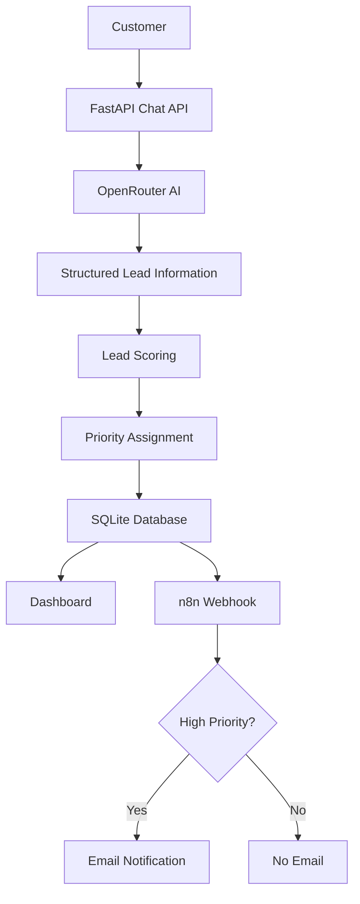

# AI Insurance Lead Qualification & Sales Automation

An AI-powered insurance lead qualification and sales automation system built with FastAPI, OpenRouter AI, SQLAlchemy, SQLite, and n8n.

## Project Overview

This project automates the early stages of insurance lead qualification.

Customers provide their information through a conversational API. AI extracts structured insurance information, calculates a lead score, assigns a priority level, generates a summary, and stores the lead in a database.

The system also integrates with n8n to automate email notifications for high-priority leads.

## Architecture



## Current Features

- AI-powered conversational lead information extraction
- Automatic lead scoring from 0 to 100
- Automatic priority classification: High, Medium, Low
- Automatic lead summary generation
- Lead creation, retrieval, updating, and deletion
- SQLite database integration
- Interactive dashboard with statistics and charts
- Lead search, filtering, sorting, and pagination
- n8n webhook integration
- Automatic email notifications for high-priority leads
- Completion notifications for qualified leads
- Prevention of duplicate completion notifications

## Technology Stack

- Python 3.12
- FastAPI
- OpenRouter AI
- OpenAI Python SDK
- SQLAlchemy
- SQLite
- Pydantic
- HTTPX
- n8n
- HTML, CSS, JavaScript
- Chart.js

## Lead Scoring

The system calculates a score based on the information provided by the customer.

| Information | Score |
|---|---:|
| Name | 10 |
| Email | 10 |
| Phone | 10 |
| Vehicle details | 15 |
| Current insurance | 10 |
| Coverage type | 15 |
| Policy expiry date | 10 |
| Urgency | Up to 20 |

### Priority Levels

| Score | Priority |
|---|---|
| 80–100 | High |
| 50–79 | Medium |
| 0–49 | Low |

## n8n Automation

The project integrates with n8n through webhooks.

The workflow:

1. Receives lead data from the FastAPI backend.
2. Checks the lead priority.
3. Sends an email when the priority is High.
4. Does not send an email for Medium or Low priority leads.

The integration has been tested with both high-priority and lower-priority leads.

## Verified Tests

| Test | Expected Result | Status |
|---|---|---|
| High-priority completed lead | Email notification sent | Passed |
| Incomplete low-priority lead | No email notification | Passed |
| Follow-up after completion | No duplicate notification | Passed |
| Dashboard search and filters | Correct results | Passed |
| Lead creation and update | Database updated | Passed |

## Project Structure

```text
AI-Insurance-Lead-Automation/
│
├── app/
│   ├── agents/
│   ├── api/
│   ├── database/
│   ├── models/
│   ├── schemas/
│   └── services/
│
├── dashboard/
├── main.py
├── .env.example
├── .gitignore
└── README.md
```

## Setup

### 1. Clone the repository

```bash
git clone https://github.com/bingbang2110-gif/AI-Insurance-Lead-Automation.git
cd AI-Insurance-Lead-Automation
```

### 2. Create a virtual environment

```bash
python -m venv .venv
```

### 3. Activate the environment

Windows PowerShell:

```powershell
.\.venv\Scripts\Activate.ps1
```

### 4. Install dependencies

Install the Python packages listed in the project's dependency file, when provided.

### 5. Configure environment variables

Create a `.env` file in the project root and configure the required OpenRouter API key and n8n webhook URL.

Never commit `.env` or API keys to GitHub.

### 6. Run the application

```bash
uvicorn main:app --reload
```

If PowerShell blocks virtual environment activation, run:

```powershell
.\.venv\Scripts\python.exe -m uvicorn main:app --reload
```

## Application URLs

- API: http://127.0.0.1:8000
- Swagger documentation: http://127.0.0.1:8000/docs
- Dashboard: http://127.0.0.1:8000/dashboard

## Project Status

**Completed MVP**

The core backend, AI-powered lead qualification, dashboard, and n8n email automation have been implemented and tested.

## Future Improvements

- CRM integration
- Support for additional insurance products
- Advanced analytics and reporting
- Improved AI reliability and validation
- Production deployment and monitoring

## Screenshots

### Analytics Dashboard


### Leads Table


### Search and Filters


### Add New Lead


## Author

GitHub: https://github.com/bingbang2110-gif